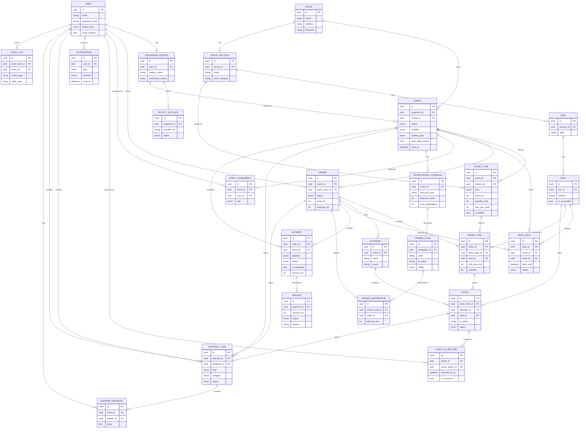

# ticketoff — Data Model (ERD)

Единый источник правды по данным платформы: 24 сущности из раздела 6 ТЗ, их ключевые
поля, статусы и связи. Утверждаем перед тем, как писать модели и первую миграцию.

- **БД:** PostgreSQL · **ORM:** SQLAlchemy 2.0 (async) · **Миграции:** Alembic
- **Валюта:** KZT · **MVP:** платежи/выплаты симулируются, реальных денег нет

Обозначения связей («воронья лапка»): `||` — ровно один, `o{` — ноль или много,
`|{` — один или много. `PK` — первичный ключ, `FK` — внешний ключ.

## ER-диаграмма

## Сущности по доменам

Ключевые `enum`-статусы задают бизнес-логику — держим их согласованными у всех.

### Identity & Access
- **User** — аккаунт с email/паролем. `system_role`: `attendee` · `platform_admin`.
- **OrganizerProfile** — профиль организатора. `verification_status`: `unverified` · `pending` · `verified`.
- **PayoutAccount** — счёт для выплат (sandbox).
- **StaffAssignment** — назначение пользователя контролёром (Event Admin) на конкретное событие.

### Events & Venue
- **Event** — событие. `status`: `draft` · `published` · `cancelled` · `completed`. `visibility`: `public` · `unlisted` · `private`. `seating_type`: `general` · `assigned`.
- **Venue** — предопределённая площадка.
- **VenueSection** — секция + ценовая категория.
- **Row** — ряд в секции.
- **Seat** — место; помечает доступные (`is_accessible`).

### Seating
- **SeatHold** — временная атомарная бронь места на время checkout. `status`: `held` · `released` · `converted`.

### Orders & Tickets
- **TicketType** — тип билета. `kind`: `free` · `paid`.
- **Order** — заказ/регистрация. `status`: `pending` · `paid` · `free_confirmed` · `cancelled` · `refunded`.
- **OrderItem** — строка заказа: тип×кол-во или одно место.
- **Ticket** — один вход с уникальным QR. `status`: `valid` · `checked_in` · `cancelled` · `refunded`.
- **Attendee** — гость, указанный в билете (может не иметь аккаунта).

### Payments
- **Payment** — движение денег (симуляция). `purpose`: `ticket_order` · `activation`. `status`: `pending` · `succeeded` · `failed`.
- **Refund** — возврат по платежу. `status`: `pending` · `succeeded` · `failed`.

### Ops & Support
- **CheckInRecord** — скан на входе; поддерживает отмену (`is_reversed`).
- **Notification** — исходящее уведомление. `channel`: `email` · `in_app`.
- **SupportCase** — тред поддержки. `kind`: `attendee` · `organizer`. `status`: `open` · `in_progress` · `waiting_customer` · `resolved`.
- **SupportMessage** — сообщение внутри кейса.

### Promotions
- **PromotionalCampaign** — скидочная кампания события. `discount_type`: `percent` · `fixed`.
- **PromoCode** — промокод + токен Campaign QR. `status`: `active` · `disabled` · `exhausted` · `expired`.
- **PromoRedemption** — факт применения кода к заказу.

### Audit
- **AuditLog** — неизменяемая запись значимого действия (кто, что, над чем, когда).

## Ключевые решения

1. **Роли — три механизма, а не одно поле.** `User.system_role` (attendee / platform_admin), способность организатора — через `OrganizerProfile`, Event Admin — через `StaffAssignment` на конкретное событие. Один человек может быть и покупателем, и организатором.
2. **Плата за активацию ≠ оплата билетов.** Обе идут через `Payment`, разделяются полем `purpose`: `activation` ссылается на `Event`, `ticket_order` — на `Order`.
3. **Места не продаются дважды.** `SeatHold` с `held_until` + уникальное ограничение в БД. Бронь: `held` → `converted` при покупке, либо `released` по таймауту. Резервация атомарна.
4. **Два разных QR.** `Ticket.qr_token` — вход на событие; `PromoCode.qr_token` — трекируемая ссылка кампании. Сканер контролёра принимает **только** билетные токены и никогда — промо.
5. **Деньги симулируются.** `Payment.is_simulated = true` для всего MVP; демо-записи никогда не подаются как реальные транзакции.
6. **Аудит только на добавление.** `AuditLog` неизменяем — никаких edit/delete через интерфейсы.
7. **Гость ≠ покупатель.** Покупатель — это `User` (`Order.buyer_user_id`); `Attendee` — имя на билете, у него может не быть аккаунта.

---

_ticketoff · CSCI 361 Software Engineering — черновик модели данных (раздел 6 ТЗ). Правки вносятся в этот документ и в первую миграцию через PR._
